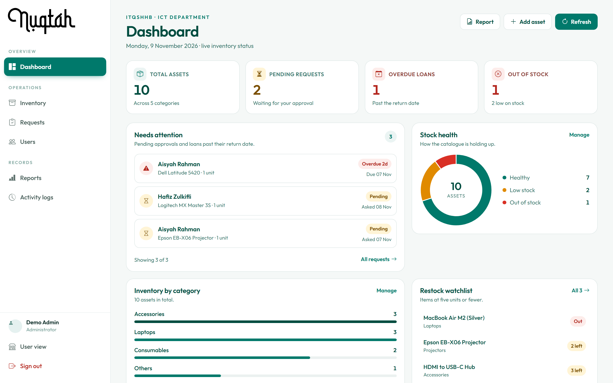
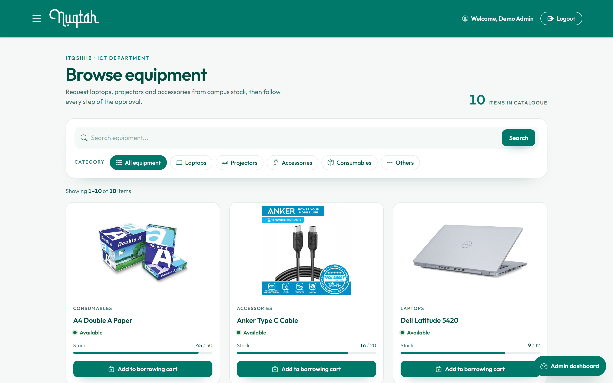
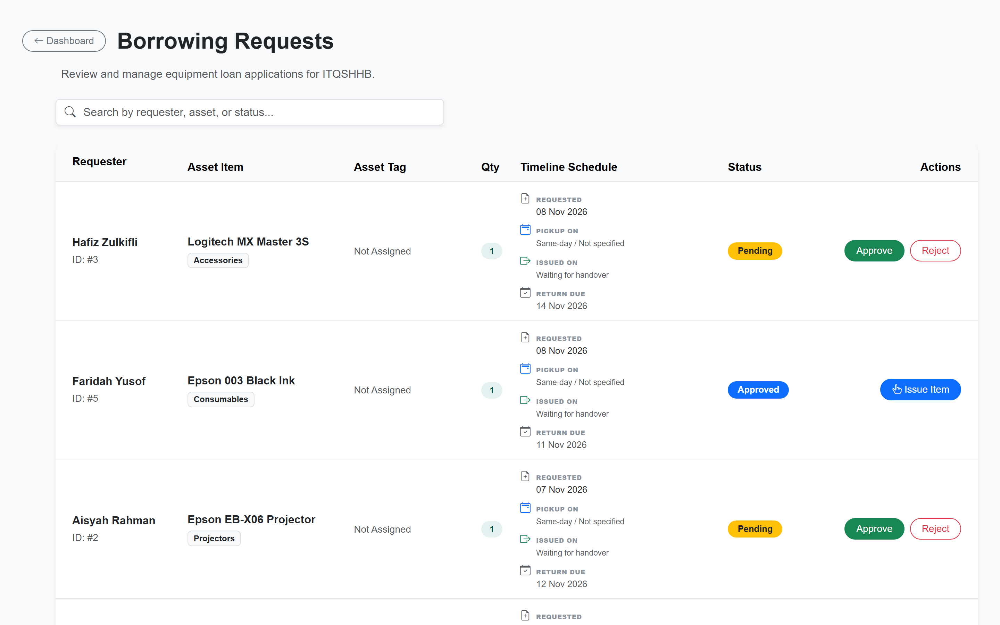
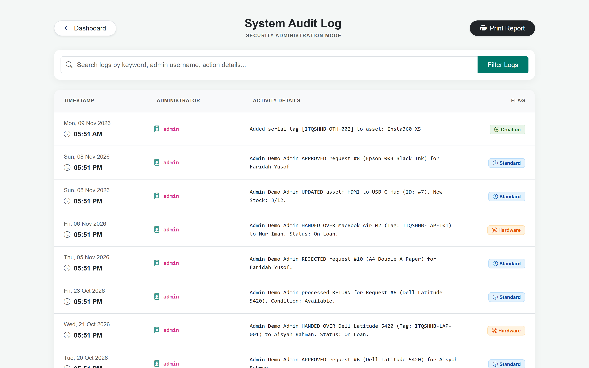
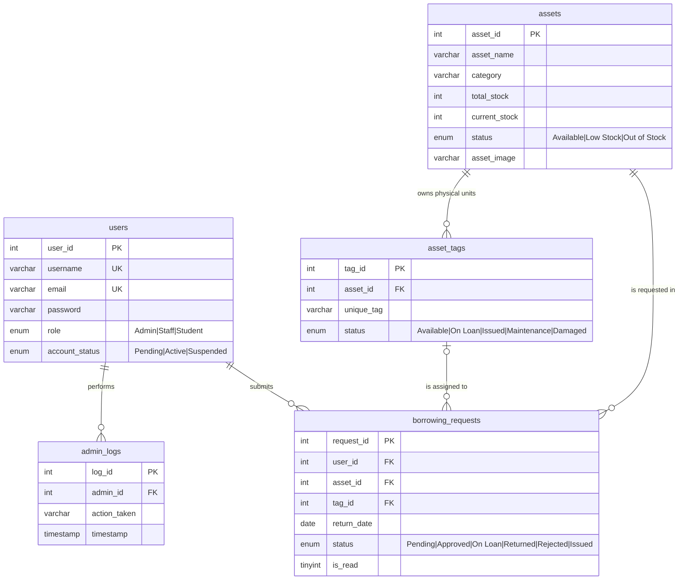

# Nuqtah IT — Inventory & Asset Borrowing System

A web-based ICT asset management system for a school's IT department: track inventory, manage serial-tagged hardware, handle borrowing requests end-to-end, and keep an audit log. Built with plain PHP and MySQL, no framework.

**Live demo:** _not deployed yet — the screenshots below show this build running against the seeded data._
**Read-only demo · seeded data · no signup required**

> Visitors can log in and browse everything. Actions that would change data are blocked with a notice, so the demo never breaks and never needs reseeding.

---

## Source of truth

This is a **demo build** of the Nuqtah IT system: the same application, with
seeded data, a read-only guard and a Docker/Railway deployment target. The full
development history lives in the original repository:

**https://github.com/Zylioth/Nuqtah-Inventory_Management_System**

Changes for this build are limited to seeding, demo-mode enforcement,
deployment files and documentation. Application logic is otherwise unchanged,
apart from bugs that were visible in the demo itself.

## Screenshots

Captured from this build running against `seed.sql` with `DEMO_MODE=true`.

| | |
|---|---|
|  |  |
| **Admin dashboard** — counters, stock health, the requests that need attention | **Inventory catalogue** — search, category filters, per-asset stock |
|  |  |
| **Request queue** — every lifecycle state, each with the action it allows next | **Activity log** — the audit trail written by every admin action |

---

## What it does

**Requester side**

- Browse inventory with search, category filter and stock indicators
- Add items to a cart and submit one borrowing request for several assets at once
- Track request status, read admin notes, get notified of decisions
- Self-service account: sign up (email activation), forgot/reset password

**Admin side**

- Dashboard: total assets, pending requests, low stock, out of stock, overdue loans
- Inventory CRUD with image upload and stock levels
- Per-unit serial tags (`ITQSHHB-LAP-001`, …) with their own lifecycle
- Request queue: approve, reject with a reason, hand over a specific tagged unit, process returns with a condition note
- User management: roles, account activation, suspension
- Reports and a full activity log

### Request lifecycle

```
Pending ──approve──> Approved ──handover──> On Loan ──return──> Returned
   │                     │                      │
   └──────reject─────────┴──────────────────────┴──> Rejected
```

`Issued` exists as a separate state for items collected but not yet confirmed on loan, matching how the department actually works.

---

## Demo accounts

All accounts share the password **`demo1234`**.

| Username  | Role    | What it shows                                  |
|-----------|---------|------------------------------------------------|
| `admin`   | Admin   | Full back office                                |
| `aisyah`  | Student | Requests in Pending / On Loan / Returned states |
| `hafiz`   | Student | An overdue loan                                 |
| `nuriman` | Staff   | An issued item awaiting confirmation            |
| `faridah` | Staff   | An approved request and a rejected one          |
| `azman`   | Student | Account still `Pending` (activation flow)       |
| `rosnah`  | Staff   | Account `Suspended` (blocks login)              |

---

## Tech stack

| Layer     | Choice                                                        |
|-----------|---------------------------------------------------------------|
| Backend   | PHP 8 (procedural, no framework)                               |
| Database  | MySQL / MariaDB, PDO with prepared statements throughout        |
| Frontend  | Server-rendered PHP, Bootstrap 5, vanilla JS, hand-written CSS |
| Email     | PHPMailer over SMTP (vendored, no Composer)                   |
| Hosting   | Docker → Railway, MySQL add-on                                 |

---

## Architecture

No framework, no router: each page is a PHP script that includes shared partials. Mutating operations live in `actions/` (requester side) and `admin/actions/` (admin side) and respond with a redirect, so every write is a POST-then-redirect rather than an inline handler.

```
request ──> page script ──> includes/db_connect.php ──> PDO (MySQL)
                │                    │
                │                    └── includes/demo_mode.php   ← read-only guard
                ├──> includes/header.php | admin/includes/sidebar.php   ← layout
                └──> POST ──> actions/*.php ──> redirect back
```

### Data model



`assets` holds aggregate stock; `asset_tags` holds the individual tagged units. A borrowing request points at the asset for reporting and at a specific tag for the physical handover.

---

## Read-only demo mode

The public demo must not let strangers mutate data, but editing ~18 mutating endpoints by hand invites a missed one. Instead the rule is structural, enforced once in `includes/demo_mode.php`:

1. anything under an `actions/` directory is blocked;
2. mutating scripts outside `actions/` are listed explicitly;
3. any POST to a page is blocked;
4. login and logout stay allowed — they touch the session, never the database;
5. two read-only AJAX helpers are allowlisted, because the handover form needs them.

Blocked requests redirect back with a one-shot notice. No cron job, no reseeding, no "restore demo data" button — the demo is stateless by construction.

`tests/demo_guard_test.php` asserts all 40 cases, so a refactor that reopens a write path fails the test instead of the public demo:

```
php tests/demo_guard_test.php
40 cases, 0 failed
```

Outside demo mode (`DEMO_MODE` unset or `false`) the application is fully functional. Outgoing email is likewise redirected to `storage/mail.log` in demo mode, so the demo can be exercised without touching a real mailbox.

---

## Running locally

### Docker (recommended — same image as production)

```bash
docker compose up --build
# http://localhost:8080
```

MySQL is seeded from `schema.sql` and `seed.sql` on first boot. To start fresh:

```bash
docker compose down -v && docker compose up --build
```

### XAMPP

1. Copy the project into `htdocs/`.
2. `cp .env.example .env` and set `DB_*` for your MySQL.
3. Import `schema.sql`, then `seed.sql` (phpMyAdmin or `mysql -u root < schema.sql`).
4. Open `http://localhost/<folder>/`.
5. Leave `DEMO_MODE` unset to use the app fully.

### Railway

The repository ships `railway.json` (Dockerfile builder) and a `Dockerfile` whose
entrypoint rebinds Apache to `$PORT`, so nothing has to be configured in the
image itself.

1. **New Project → Deploy from GitHub repo**, pick this repository.
2. **Add a MySQL service** to the same project and reference it from the app.
   The plugin injects `MYSQLHOST`, `MYSQLPORT`, `MYSQLDATABASE`, `MYSQLUSER` and
   `MYSQLPASSWORD`; `includes/db_connect.php` reads those directly when no `.env`
   is present, so no database variables need to be written by hand.
3. Set `DEMO_MODE=true` on the app service. That is the only variable the demo
   needs.
4. **Import the data once.** Unlike `docker-compose.yml`, a managed MySQL service
   starts empty, so `schema.sql` then `seed.sql` have to be loaded against the
   service's public endpoint:
   ```bash
   mysql -h <host> -P <port> -u <user> -p <database> < schema.sql
   mysql -h <host> -P <port> -u <user> -p <database> < seed.sql
   ```
   `seed.sql` truncates every table, which is why it only ever runs against a
   fresh demo database.
5. **Generate a domain** under the service's Settings → Networking.

Because the guard is stateless, the demo needs no cron, no reseed job and no
"restore data" button after the first import.

---

## Project structure

```
├── index.php                  landing page
├── login.php / signup.php     auth entry points
├── inventory_list.php         searchable asset catalogue
├── cart.php                   multi-item borrowing request
├── my_requests.php            requester's requests + notifications
├── admin/
│   ├── index.php              dashboard with counters
│   ├── manage_assets.php      inventory CRUD + pagination
│   ├── view_requests.php      approve / reject / handover / return
│   ├── manage_users.php       roles and account status
│   ├── report.php             reports
│   ├── admin_logs.php         audit trail
│   ├── includes/sidebar.php   admin layout
│   └── actions/               admin write endpoints
├── actions/                   requester write endpoints
├── includes/
│   ├── db_connect.php         PDO connection + env loader
│   ├── demo_mode.php          read-only guard
│   ├── mail_helper.php        PHPMailer wrapper
│   └── header.php / footer.php
├── assets/                    css, js, images, uploads
├── vendor/phpmailer/          vendored PHPMailer
├── tests/                     demo guard checks
├── docs/screenshots/          README images
├── schema.sql                 structure
├── seed.sql                   demo data (relative dates, never goes stale)
├── Dockerfile
└── docker-compose.yml
```

---

## What I'd do differently

Kept honest, because these are the parts worth discussing:

- **No CSRF protection.** Mutating endpoints use `$_REQUEST`, so several admin actions can fire from a GET link. A per-session token on every form and a POST-only rule would be the first fix.
- **`asset_tags.unique_tag` has no UNIQUE constraint.** Duplicates are prevented only by a `SELECT COUNT(*)` check in application code — a race condition, and the seeded original data already contained a duplicate tag.
- **Inconsistent missing-image handling.** `inventory_list.php` checks `file_exists()` before rendering an image; `admin/manage_assets.php` does not, so the same asset can render a placeholder on the storefront and a broken image in the admin table. The schema default `default_asset.png` did not exist either.
- **Stock status is stored *and* derived, and the two disagree.** `assets.status` is an `ENUM` column, but the dashboard counters ignore it and compute from `current_stock` (`> 0 AND <= 5` = low stock). The threshold is absolute rather than proportional, so a fully stocked item with a small total — say 5 of 5 cables — is reported as low stock. The seed keeps both in agreement so the demo is coherent; a single derived status would be the real fix.
- **Role checks are duplicated per endpoint.** `$_SESSION['role'] !== 'Admin'` appears in every admin script rather than in one guard, so a new endpoint can silently miss it.
- **Quantity is modelled by cloning rows.** Approving a request for N items inserts N−1 single-unit rows, so `quantity` is effectively always 1 and a per-row invariant carries the meaning. A proper `request_items` table would be cleaner.
- **Dead include.** `includes/functions.php` is a 0-byte file that is included by convention but defines nothing.
- **No Composer.** PHPMailer is vendored by hand, which works but makes updates manual.

---

## Credit

Built for the ICT department of **ITQSHHB** as an academic project. This repository is the public, seeded demo build. The full development history and original source live in [Nuqtah-Inventory_Management_System](https://github.com/Zylioth/Nuqtah-Inventory_Management_System).
